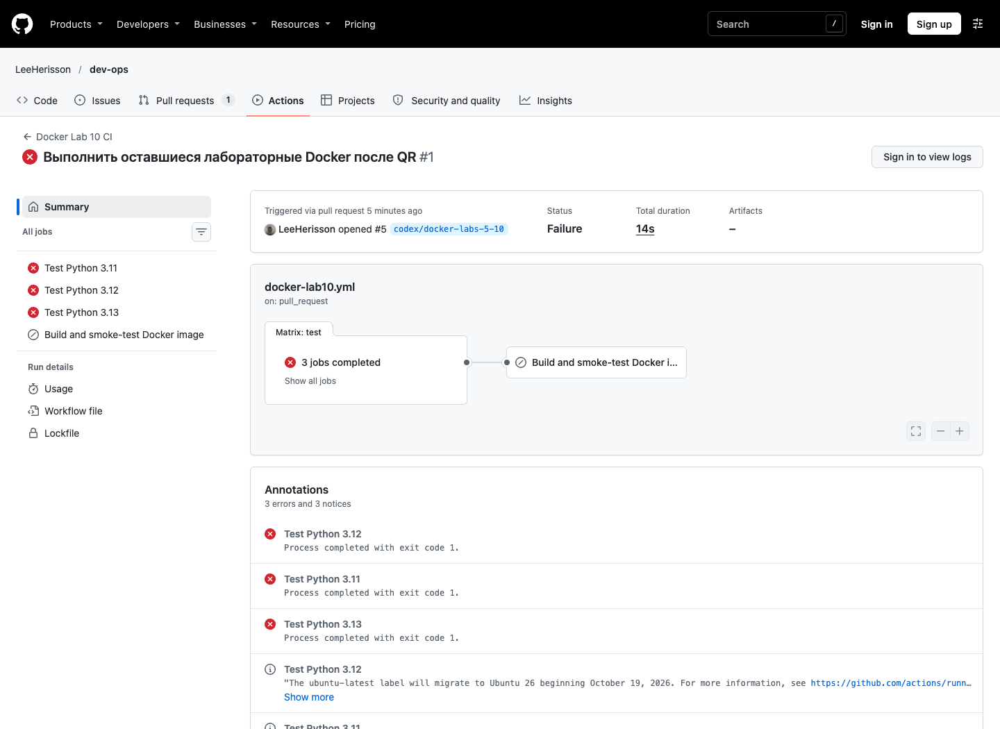
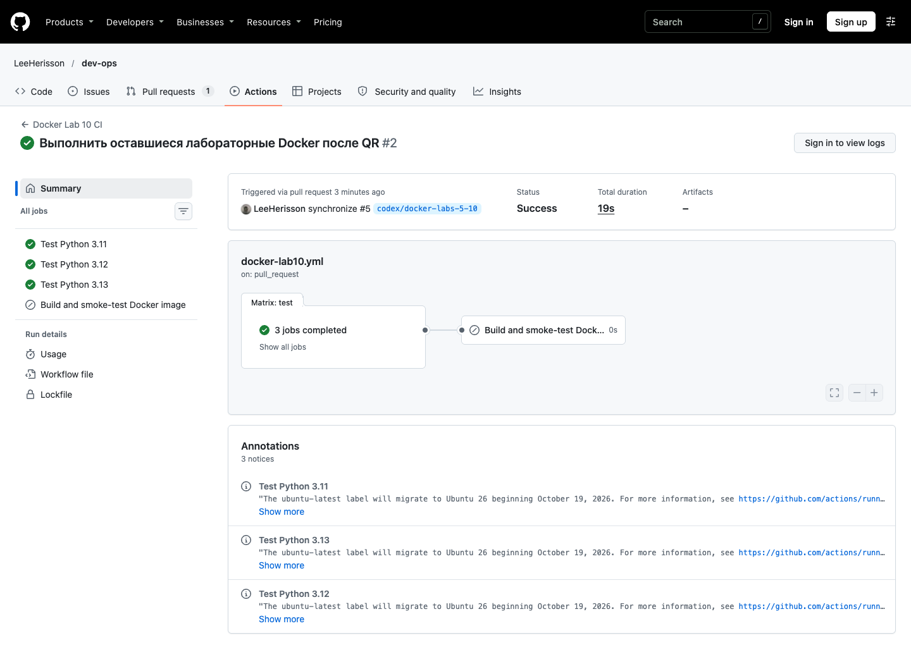

# Отчёт — CI и Docker для ToDo

Дата: 4 ноября 2026 года. Исходник: «Лабораторная работа 3 — CI/CD с GitHub Actions», неделя 6. Сквозной номер папки в этом комплекте — 10.

## Реализация

Flask API имеет маршруты `GET /health`, `GET /todos`, `POST /todos`. Валидация дополнительно отклоняет массив вместо объекта, нестроковый/пустой и слишком длинный заголовок. SQL не используется: список задач намеренно хранится в памяти, как в исходном starter.

Dockerfile разделяет wheels, test и runtime. Test-stage выполняется явно. Runtime работает с UID/GID `10001:10001`, не содержит pytest и имеет HTTP-healthcheck. `STOPSIGNAL SIGINT` обеспечивает корректную остановку учебного Flask-сервера, работающего как PID 1.

Workflow `.github/workflows/docker-lab10.yml` лежит в корне монорепозитория. Матрица тестирования использует Python 3.11/3.12/3.13. Сборка зависит от тестов через `needs` и пропускается для PR. Для runtime выполняется реальная HTTP-проверка. Публикация Docker Hub исключена по прямому уточнению пользователя; Docker Hub secrets не требуются.

## Фактически выполненные локальные проверки

| Проверка | Результат | Доказательство |
|---|---|---|
| Четыре исходных и шесть дополнительных API-тестов | 10 passed | `evidence/local-tests.log` |
| Те же тесты в Docker test-stage | 10 passed | `evidence/docker-test-build.log` |
| Намеренно сломанный `/health`: OK вместо ok | `test_health` ожидаемо упал | `evidence/intentional-failure.log` |
| Исправленная реализация | 10 passed | `evidence/local-tests.log` |
| Реальные HTTP-запросы контейнера | Health 200, создание 201, чтение 200, неверный ввод 400 | `evidence/http-check.json` |
| Непривилегированный runtime | UID не равен 0 | `evidence/runtime-check.log` |
| Pytest отсутствует в runtime | `find_spec('pytest') is None` | `evidence/runtime-check.log` |
| Штатная остановка | Exit code 0 | `evidence/shutdown.txt` |

Локальная платформа Docker: Engine 29.9.2, `linux/arm64`. Размеры image и расчёт приведены в `evidence/verification.json`. Размер `.Size` сравнивается в байтах, без смешения с размером сжатого registry-артефакта. Пятикратное уменьшение не является требованием этой CI-работы; такой критерий проверяется отдельно в оптимизации React.

## Объяснения для защиты

`test_health` упал из-за различия регистра `OK` и `ok`: ответ API нарушил ожидаемый контракт. Лог отрицательного опыта получен на отдельной временной копии, финальный код исправен.

`needs: test` запрещает сборку после неуспешных тестов. Без него jobs независимы и могут стартовать параллельно. Успех тестов сам по себе не отменяет `if`: в PR сборка помечается skipped.

Checkout нужен в каждой job, поскольку runner/рабочая папка не передаются между jobs. `run` исполняет shell-команду, `uses` вызывает action. `permissions: contents: read` ограничивает автоматический токен GitHub и не является настройкой прав Docker Hub.

Commit SHA в теге связывает имя образа с кодом по соглашению. Digest идентифицирует содержимое образа. В этой работе теги остаются локальными у runner: образ в Docker Hub не публикуется.

После остановки ToDo теряет задачи, поскольку они находятся в RAM. Наличие произвольного volume это не исправит без изменения приложения.

## GitHub Actions

Реальный отрицательный запуск: https://github.com/LeeHerisson/dev-ops/actions/runs/41783945392. На всех трёх версиях Python упал именно `test_health`: `OK` не совпало с `ok`. Сборка была пропущена. Доказательства: `evidence/github-negative-run.json` и `evidence/github-negative-job.log`.

Реальный исправленный PR-запуск: https://github.com/LeeHerisson/dev-ops/actions/runs/41784111437. Все 10 тестов прошли на Python 3.11, 3.12 и 3.13; job сборки отмечена skipped согласно условию PR. Доказательство: `evidence/github-fixed-pr-run.json`.

Pull request: https://github.com/LeeHerisson/dev-ops/pull/5. Запуск сборки основной ветки фиксируется после интеграции готовых лабораторных.

### Скриншоты реальных удалённых запусков

