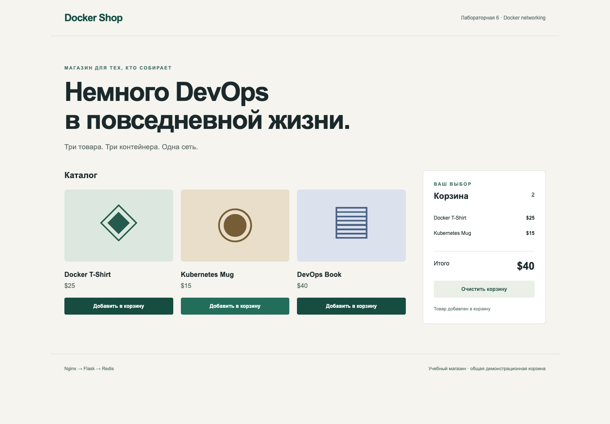
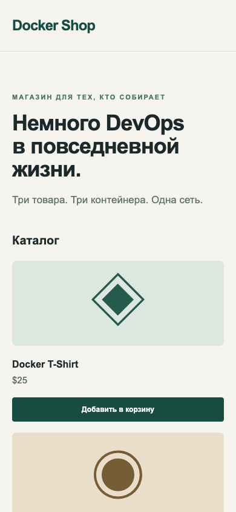

# Отчёт по лабораторной 6 Docker Networking

Исходное задание: **Docker Advanced, ЛР2 «Магазин с корзиной»**, `Docker_Week4 laby.pdf`, стр. 15–19. Номер 6 относится к локальной последовательности папок после ранее выполненных работ. Выполнена реальная сборка, запуск и функциональные проверки.

## Среда и результат

Измерено: `2026-11-04T06:05:49.987563+00:00` (UTC). Docker Engine `29.9.2`, Linux `arm64`, context `desktop-linux`. Три контейнера были `healthy` во время сбора evidence. `start.sh` не использует Docker Compose.

**15/15 HTTP/DNS проверок прошли.** Дополнительный браузерный сценарий: PASS, 3 проверки. Результаты взяты из фактических JSON, а не подставлены как ожидаемые значения.

| Образ | Размер, байты из image inspect | Архитектура |
| --- | ---: | --- |
| devops-lab6-backend:1.0 | 229270799 | arm64 |
| devops-lab6-frontend:1.0 | 93244832 | arm64 |
| redis:7-alpine | 58214993 | arm64 |

Image IDs, container IDs, фактические порты и health находятся в `evidence/environment.json`; сборка — в `evidence/build-start.log`.

## Соответствие условию

| Требование | Реализация и доказательство |
| --- | --- |
| Три контейнера | Nginx frontend, Flask backend, Redis; проверки ровно трёх endpoints сети |
| Пользовательская сеть | `devops-lab6-network`, driver bridge |
| Frontend localhost:8080 | Страница магазина и реальные HTTP-запросы через Nginx |
| Backend localhost:5000 | Прямой GET products/cart проверен отдельно |
| Redis-корзина | Цены 25/15/40, сумма двух товаров 40 и трёх 80 |
| Frontend вызывает backend | Относительные fetch `/api`, Nginx proxy на DNS alias backend |
| Backend использует имя Redis | `REDIS_HOST=redis`, DNS и ping на прикладном уровне |
| start.sh | docker build/network/run, ожидание health, проверка ownership labels |

## Реальные проверки

| № | Проверка | Результат |
| --- | --- | --- |
| 1 | Nginx same-origin proxy returns 3 products | PASS |
| 2 | Source prices are 25, 15, 40 | PASS |
| 3 | Backend published on its own port | PASS |
| 4 | Flask reaches Redis by DNS alias | PASS |
| 5 | Reset empties dedicated demonstration cart | PASS |
| 6 | POST adds product 1 | PASS |
| 7 | POST adds product 2 | PASS |
| 8 | Backend and Nginx share cart, two products total 40 | PASS |
| 9 | Unknown product returns 404 | PASS |
| 10 | Invalid product leaves cart unchanged | PASS |
| 11 | Three products total 80 | PASS |
| 12 | Unknown API route returns JSON 404 | PASS |
| 13 | All aliases resolve in user-defined bridge | PASS |
| 14 | Exactly the required three containers are in bridge | PASS |
| 15 | UI and script are served; API URL is relative | PASS |

В browser-сценарии корзина очищается кнопкой, затем добавляются футболка и кружка. Поэтому на UI-скриншоте показаны **2 товара и $40**, а HTTP-тест отдельно проверил и сценарий **3 товара / $80**. Оба результата относятся к своим реальным действиям.

## Короткие ответы для защиты

**Почему Docker DNS работает?** Все три контейнера подключены к user-defined bridge, в котором разрешаются имена и network aliases. Backend не хранит IP Redis.

**Где выполняется JavaScript?** В браузере. Поэтому UI обращается к относительному `/api`; только Nginx использует внутреннее `backend:5000`. CORS для такого запроса не требуется, потому что origin один.

**Почему Redis не имеет published port?** API и Redis общаются внутри одной сети по 6379. Наружу публикуются только нужные учебные HTTP-порты.

**Что происходит с корзиной после удаления контейнеров?** В этой сетевой работе Redis использует tmpfs и отключённую дисковую persistence. Корзина демонстрационная, общая, при пересоздании сбрасывается. Постоянные данные проверяются в отдельной лабораторной по Compose.

**Что улучшено относительно фрагмента PDF?** Неизвестный product_id возвращает 404 вместо ложного success; есть обработка Redis outage, Gunicorn/non-root API, healthchecks, ожидание готовности, защищённые имена ресурсов и автоматические сценарии.

## Ограничения и окончание работы

Это учебный магазин без учётных записей, оплаты и индивидуальных корзин. Образ в registry не публиковался. Финальная остановка выполняется `./stop.sh`; фактический результат записан в `evidence/final-state.json`. Скриншоты сделаны с реально запущенной страницы. Другие контейнеры и данные не удалялись.
