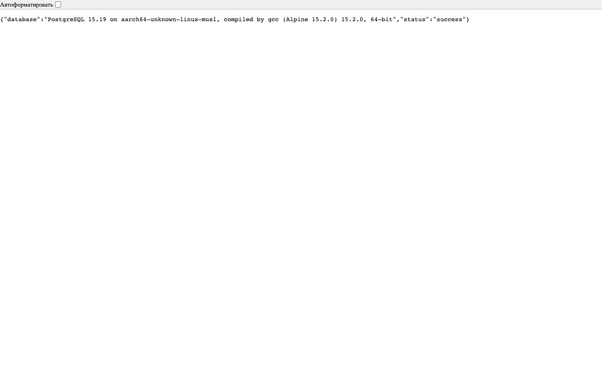
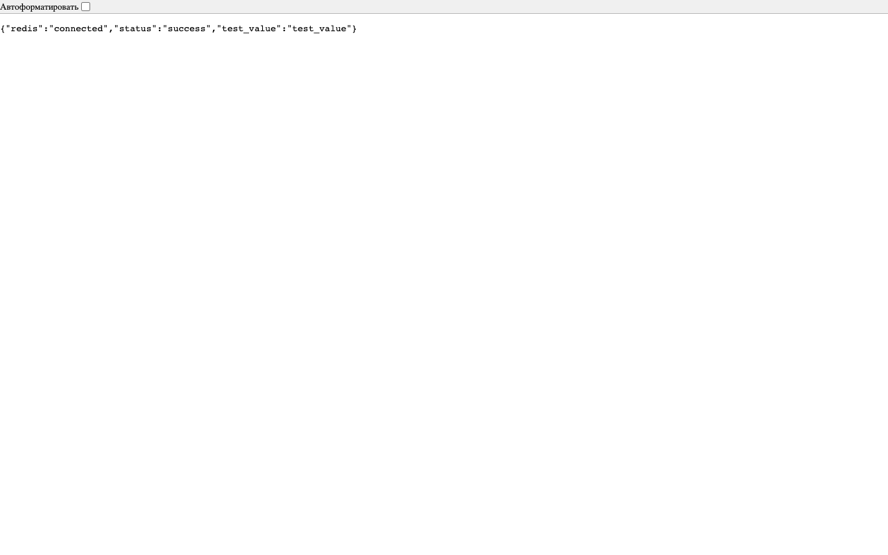
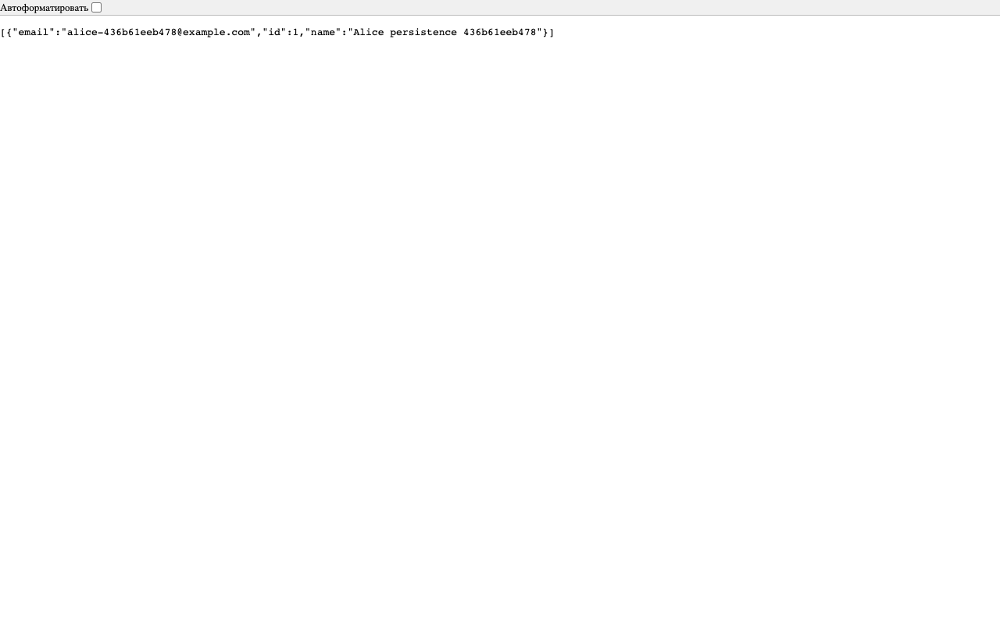

# Отчёт по лабораторной 9 Docker Compose

Исходное задание: **ЛР5 «Multi-container приложение с Docker Compose»**, `Docker_Compose.pdf`, стр. 22–29. Номер 9 — локальный номер папки. Реализованы все три обязательных сервиса и все семь endpoints. Опциональный Nginx не добавлялся.

## Среда и итог

Измерено: `2026-11-04T06:07:06.599385+00:00` (UTC). Docker Engine `29.9.2`, Compose `5.6.1`, Linux `arm64`. API, PostgreSQL и Redis были `healthy` во время проверки.

**Все 31 автоматических проверок прошли.** Реальные ответы, промежуточные состояния, IDs и выполненные команды сохранены в `evidence/checks.json`. Пароля в отчётах, API-коде и evidence нет; локальный `.env` имеет mode `0o600` и не предназначен для Git/архива сдачи.

| Образ | Размер, байты из image inspect | Архитектура |
| --- | ---: | --- |
| devops-lab9-api:1.0 | 241454924 | arm64 |
| postgres:15-alpine | 407768179 | arm64 |
| redis:7-alpine | 58214993 | arm64 |

## Соответствие исходным критериям

| Критерий из PDF | Реализация |
| --- | --- |
| Правильно структурированный Compose | services api/db/redis, backend network, volumes; config --quiet и реальный up |
| Все endpoints | /, /health, /db-test, /cache-test, POST/users, GET/users, GET/users/id |
| Healthcheck DB и Redis | pg_isready и redis-cli ping; дополнительный HTTP health API |
| depends_on с condition | API ждёт service_healthy у обеих зависимостей |
| Env через .env | configure.sh создаёт случайный пароль и согласованные DB-настройки |
| Volumes PostgreSQL и Redis | `devops-lab9-postgres-data`, `devops-lab9-redis-data` |
| Custom network | `devops-lab9-backend`, bridge, имена db/redis проверены DNS |
| Одна команда запуска | ./start.sh, build/up/wait |
| Секреты исключены из Git | .env приватен, для репозитория используется локальный .git/info/exclude, example безопасен |
| README | Инструкция, API, тесты, остановка и явно отдельный сброс volumes |

Баллы не выставлялись: отчёт фиксирует результаты, оценивание выполняет преподаватель. Источник просит .gitignore, но пользователь выбрал локальный `.git/info/exclude`; сохранён сам смысл исключения секретов из Git.

## Доказательство persistence

Проверка создала пользователя **id=1**, name=`Alice persistence 436b61eeb478`, email=`alice-436b61eeb478@example.com`. В тесте выполнен `docker compose down` **без -v**, затем `up -d --wait`. Все три container IDs изменились, а имена mounts остались прежними.

- Старый PostgreSQL container ID: `a6077db7ac9809bf7bab036f94abd14d7e6f394be83b831e4355528a7b497a83`.
- Новый PostgreSQL container ID: `240084d1cbd5bf194d32c29b146675df686d3cf82fdf1ce195c1a51c4fadbd95`.
- Тот же пользователь присутствовал в GET/users после создания новых контейнеров.
- Redis marker, записанный до down, прочитан после нового Redis-контейнера; AOF включён.

Это проверка удаления и создания контейнеров, а не только stop/start. Volumes остались в Engine после финальной остановки проекта.

## Реальные проверки поведения

| № | Проверка | Результат |
| --- | --- | --- |
| 1 | GET / | PASS |
| 2 | GET /health | PASS |
| 3 | GET /db-test | PASS |
| 4 | GET /cache-test | PASS |
| 5 | POST /users saves in PostgreSQL | PASS |
| 6 | GET /users includes new record | PASS |
| 7 | Cache miss reads PostgreSQL | PASS |
| 8 | Second GET reads Redis copy | PASS |
| 9 | Cached copy has bounded positive TTL | PASS |
| 10 | Duplicate email returns 409 | PASS |
| 11 | Invalid POST missing fields returns 400 | PASS |
| 12 | Invalid POST array returns 400 | PASS |
| 13 | Invalid POST wrong types returns 400 | PASS |
| 14 | Invalid POST empty name returns 400 | PASS |
| 15 | Invalid POST invalid email returns 400 | PASS |
| 16 | Missing user returns 404 | PASS |
| 17 | Unknown route returns JSON 404 | PASS |
| 18 | Unsupported method returns JSON 405 | PASS |
| 19 | Expired copy is read again from database | PASS |
| 20 | API resolves DB and Redis by service names | PASS |
| 21 | Cache health is 503 during Redis outage | PASS |
| 22 | User read falls back to DB while Redis is stopped | PASS |
| 23 | DB check is 503 during PostgreSQL outage | PASS |
| 24 | Liveness remains HTTP-process liveness | PASS |
| 25 | All three containers healthy before recreation | PASS |
| 26 | Containers really replaced, not merely restarted | PASS |
| 27 | Named volumes unchanged across down/up | PASS |
| 28 | PostgreSQL record survives new containers | PASS |
| 29 | Redis AOF marker survives new Redis container | PASS |
| 30 | Redis AOF enabled | PASS |
| 31 | API works after full recreation | PASS |

Первый GET конкретного пользователя показал `source=database`, следующий — `source=cache` и положительный TTL. Для проверки истечения один тестовый cache-key получил EXPIRE 1, после чего API снова прочитал БД. Остановка Redis дала 503 у cache-test, но чтение пользователя продолжило работать из БД. При остановке PostgreSQL db-test вернул 503, а /health остался проверкой живого HTTP-процесса.

## Реальные страницы HTTP-ответов

Создание пользователя POST/201 и ошибочные запросы содержатся в `evidence/checks.json`; эти screenshots показывают реальные GET-страницы Chrome.

## Короткие ответы для защиты

**Почему нужен Redis, если есть PostgreSQL?** Redis хранит временную копию пользователя для повторного чтения. PostgreSQL остаётся источником истины. Отказ кеша обрабатывается fallback к БД.

**Что делает depends_on?** В данном длинном синтаксисе ждёт healthchecks при первоначальном запуске. Он не гарантирует вечную доступность БД; дальнейшие отказы проверены отдельно.

**Почему нельзя просто поменять POSTGRES_PASSWORD в .env?** В существующем data volume роль уже создана. Env-параметр используется при первичной инициализации; для смены пароля существующей роли нужна согласованная SQL-ротация.

**Что удаляет down -v?** Данные named volumes этого проекта. Для обычной остановки и persistence-теста параметр -v не используется.

**Почему /health доступен без БД?** Это liveness HTTP-процесса. Доступность зависимостей измеряют отдельные /db-test и /cache-test; значения не смешиваются.

**Где находятся секреты?** Только в локальном runtime .env с mode 0600 и окружении соответствующих контейнеров. Они не зашиты в образ и не публикуются в ответах. Администратор Docker всё равно имеет доступ к runtime-конфигурации.

## Ограничения и завершение

API учебный: нет authentication, TLS, migrations framework, rate limits и промышленной email-валидации. Cache invalidation обновления/удаления пользователя не требуется, потому что такие endpoints в задании отсутствуют. Registry-публикация не выполнялась. Финальная остановка — ./stop.sh без -v, её фактическое состояние сохранено в `evidence/final-state.json`. Оба named volumes и данные оставлены для повторного запуска.
