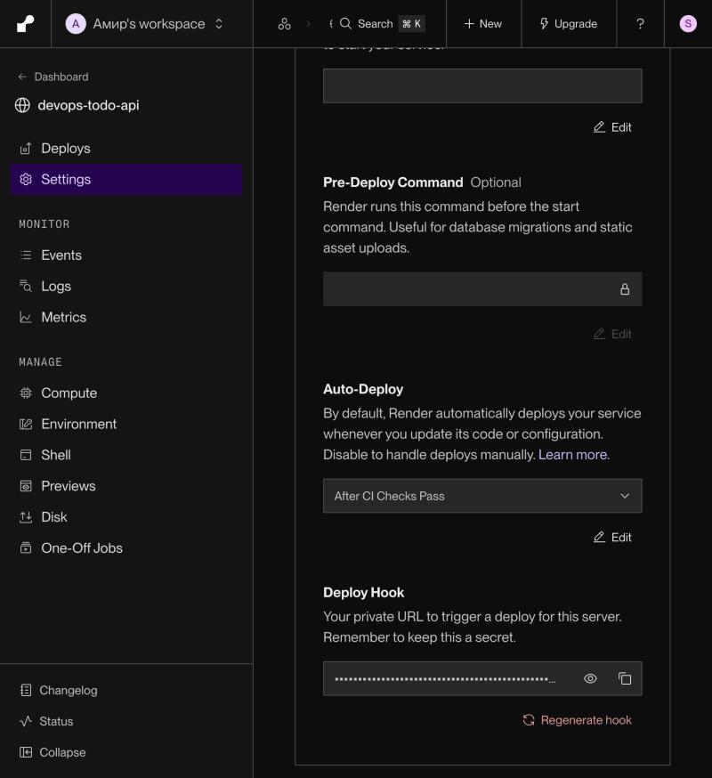
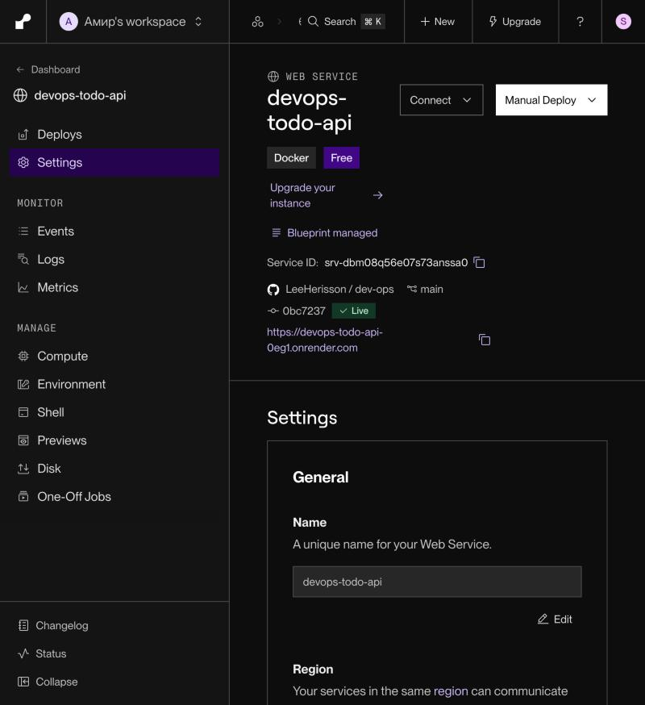
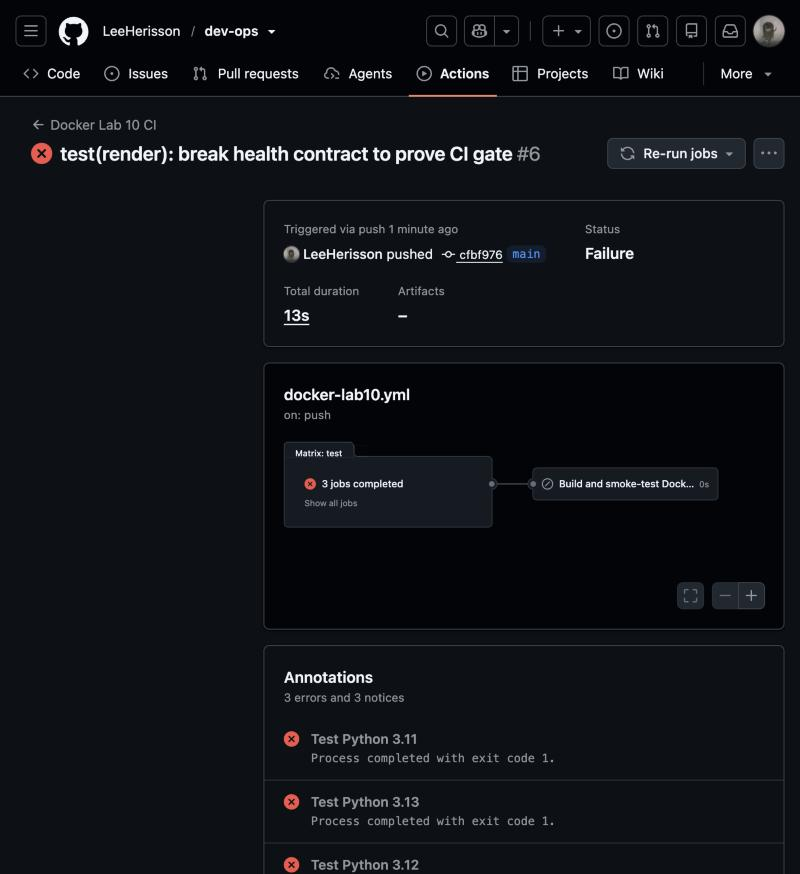
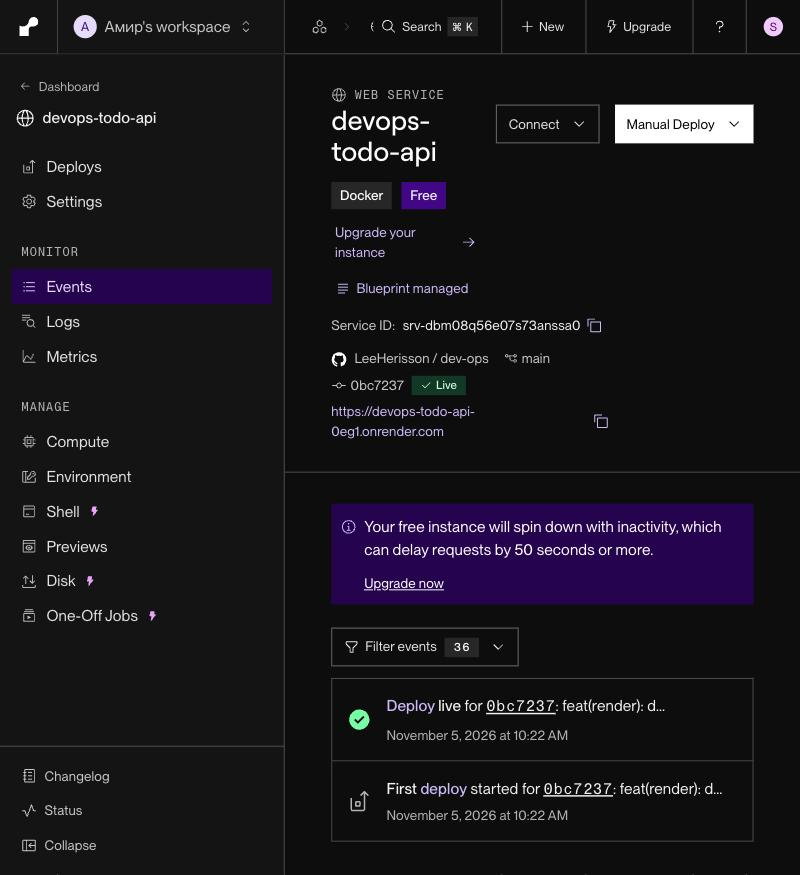
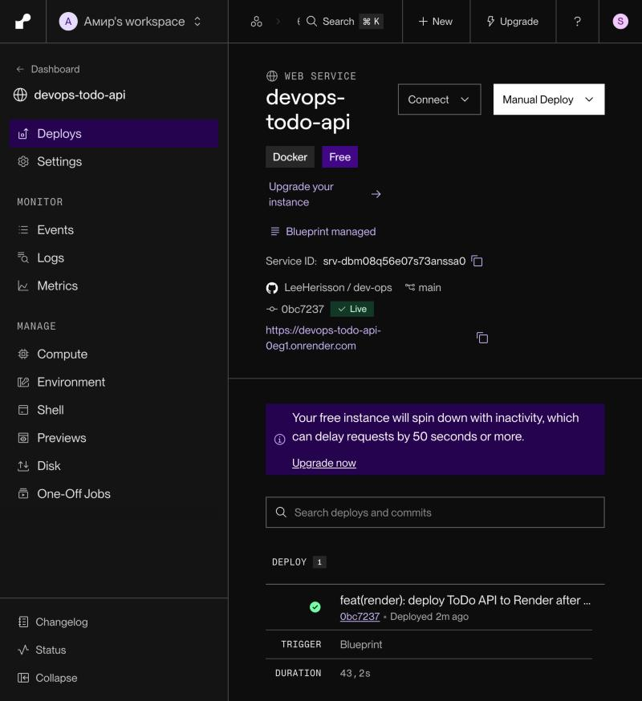
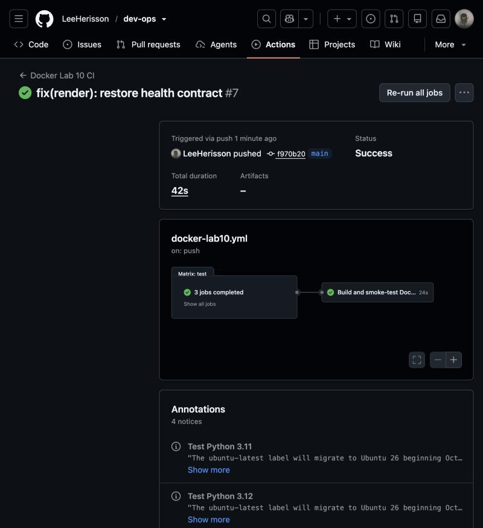
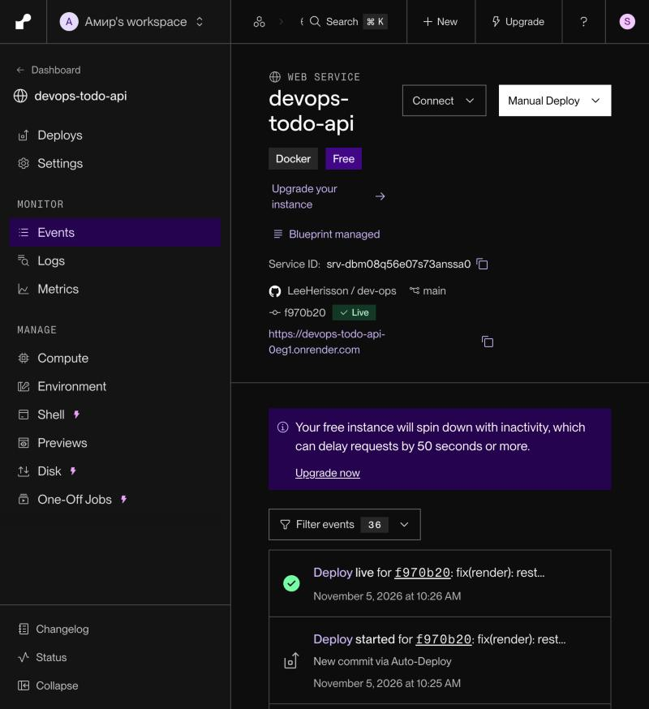
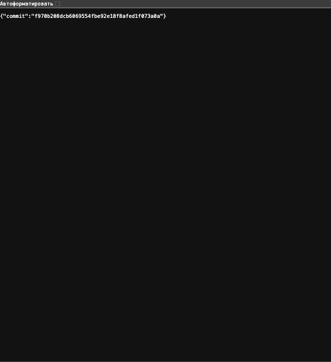

# Отчёт — деплой на PaaS (Render) с CI-гейтом

Дата: 5 ноября 2026 года.

**Публичный адрес:** https://devops-todo-api-0eg1.onrender.com
**Health-check:** https://devops-todo-api-0eg1.onrender.com/health → `200 {"status":"ok"}`
**Какой коммит на сайте:** https://devops-todo-api-0eg1.onrender.com/version

## Что задеплоено

Flask ToDo API из папки `docker-lab10-cicd` (маршруты `/health`, `/todos`, `/version`). Сборка идёт по существующему многоэтапному `Dockerfile`. Для PaaS сделаны два изменения:

- приложение слушает порт из переменной `PORT`, которую задаёт Render (healthcheck в Dockerfile тоже использует её);
- добавлен `GET /version`, который возвращает `RENDER_GIT_COMMIT` — SHA коммита, задеплоенного сейчас. По нему видно, какая версия кода на сайте. Этот маршрут покрыт тестом.

Сервис описан как код в файле [`render.yaml`](../render.yaml) в корне репозитория (Render Blueprint) и создан через **Dashboard → New → Blueprint**.

## Выбор платформы

**Render.** У обеих платформ есть нужная функция: у Railway это «Wait for CI», у Render — «After CI Checks Pass». Я выбрал Render, потому что у него есть бесплатный тариф для web-сервисов. Также на Render всю конфигурацию, включая CI-гейт, можно хранить в репозитории в `render.yaml`.

## Требования

| Требование | Как выполнено |
|---|---|
| Публичный HTTPS-адрес, `/health` отвечает | `https://devops-todo-api-0eg1.onrender.com/health` → HTTP/2 200; Render также опрашивает `healthCheckPath: /health` |
| Автодеплой после push в `main` | Сервис привязан к `LeeHerisson/dev-ops`, ветка `main`; деплой `f970b20` в Render отмечен как «New commit via Auto-Deploy» |
| Деплой только при зелёном CI | **Auto-Deploy = After CI Checks Pass** (`autoDeployTrigger: checksPass`) |

## Настройка для п. 3 и где она в документации

Включена настройка **Auto-Deploy → «After CI Checks Pass»**. В `render.yaml` она задаётся так:

```yaml
autoDeployTrigger: checksPass
```

Где найдено в документации:

1. **Deploying on Render → раздел «Automatic deploys»**: https://render.com/docs/deploys. Там написано, что в **Settings** сервиса, в поле **Auto-Deploy**, есть три варианта: *On Commit* (по умолчанию), *After CI Checks Pass* и *Off*. Там же описаны правила:
   - проверка GitHub (GitHub Actions или другой Checks API) считается пройденной, если её результат — `success`, `neutral` или `skipped`;
   - Render **не** запускает деплой, если хотя бы одна проверка коммита упала **или если проверок нет вообще**.
2. **Blueprint YAML Reference**: https://render.com/docs/blueprint-spec. Там описано поле `autoDeployTrigger` со значениями `commit`, `checksPass` и `off`.

Настройка видна в панели: [01-settings-auto-deploy-after-ci.jpg](evidence/01-settings-auto-deploy-after-ci.jpg).

Какие CI-проверки ждёт Render: на каждый push в `main` запускаются два workflow:
- `.github/workflows/docker-lab10.yml` — pytest на Python 3.11/3.12/3.13, затем сборка Docker-образа и smoke-тест;
- `.github/workflows/ci.yml` — `validate`.

Render деплоит коммит, только когда все эти проверки зелёные.

Дополнительно в `buildFilter` указано: пересобирать сервис только при изменениях в `docker-lab10-cicd/**`, кроме `*.md` и `evidence/**`. Поэтому коммиты в другие лабораторные работы не вызывают лишних деплоев.

## Доказательство: сломанный коммит не попал на сайт, исправление попало

| # | Коммит | Что изменено | CI (Docker Lab 10) | Render | `/version` на сайте |
|---|---|---|---|---|---|
| 1 | [`0bc7237`](https://github.com/LeeHerisson/dev-ops/commit/0bc72376219107c27a3bf0cde9534bc9ffb023a0) | `render.yaml`, PORT, `/version` | ✅ [run 41966523655](https://github.com/LeeHerisson/dev-ops/actions/runs/41966523655) | задеплоен (первый деплой) | `0bc7237…` |
| 2 | [`cfbf976`](https://github.com/LeeHerisson/dev-ops/commit/cfbf976) | `/health` возвращает `OK` вместо `ok` | ❌ [run 41967505010](https://github.com/LeeHerisson/dev-ops/actions/runs/41967505010) — `test_health` упал на всех трёх версиях Python | **деплой не запущен** | осталось `0bc7237…`, `/health` по-прежнему `ok` |
| 3 | [`f970b20`](https://github.com/LeeHerisson/dev-ops/commit/f970b208dcb6069554fbe92e18f8afed1f073a0a) | возвращён `ok` | ✅ [run 41967669399](https://github.com/LeeHerisson/dev-ops/actions/runs/41967669399) | задеплоен, «New commit via Auto-Deploy» | `f970b20…` |

`Lab 2 CI` (`validate`) был зелёным на всех трёх коммитах. Значит, коммит №2 заблокировал именно упавший тест: [41967505027](https://github.com/LeeHerisson/dev-ops/actions/runs/41967505027).

Ошибка из лога CI для коммита №2:

```
FAILED tests/test_main.py::test_health - AssertionError: assert {'status': 'OK'} == {'status': 'ok'}
1 failed, 10 passed
```

### Скриншоты

1. Настройка Auto-Deploy = After CI Checks Pass
   
2. Первый деплой `0bc7237` — Live
   
3. Сломанный коммит `cfbf976`: CI красный
   
4. После push `cfbf976` в Render нет нового деплоя, Live по-прежнему `0bc7237`
   
   
5. Исправление `f970b20`: CI зелёный
   
6. Render задеплоил `f970b20` автоматически («New commit via Auto-Deploy»)
   
7. Сайт отдаёт новый коммит
   

Текстовые ответы сайта с отметками времени на каждом этапе: [03](evidence/03-live-0bc7237.txt), [04](evidence/04-live-after-broken-cfbf976.txt) и [08](evidence/08-live-after-fix.txt).

## Замечания

- Бесплатный инстанс Render засыпает после простоя. Первый запрос после этого может идти около 50 секунд.
- ToDo хранит задачи в памяти, поэтому после каждого деплоя или пробуждения список пуст.
- Коммиты №1–3 запушены прямо в `main` в обход правила «только через PR» (разрешено администратору). Это нужно для демонстрации: сломанный коммит должен оказаться именно в `main`.
